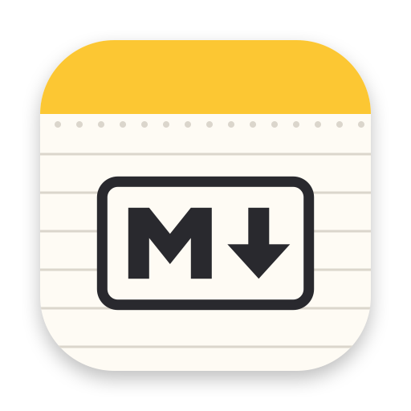

<p align="center"></p>

# Заметки.md

[](https://github.com/Dubieroj/notes-md/actions/workflows/tests.yml)

[English](README.md) · **Русский**

**Notes.md** — заметки для Mac, как «Заметки» Apple, только каждая заметка — обычный файл Markdown. Папки, смарт-папки, теги, закреплённые, «Недавно удалённые», быстрая заметка, блокировка паролем и Touch ID, виджеты, поиск в Spotlight — а данные остаются простыми `.md`-файлами, которые можно открыть любым редактором и положить в git. Работает офлайн, без аккаунтов и сети.

**Открытый исходный код.** Код передан в общественное достояние ([Unlicense](LICENSE)): берите, меняйте, встраивайте, продавайте — без условий и без упоминания автора.

Концепция и ТЗ — в [docs/SPEC.md](docs/SPEC.md), формат заблокированных заметок — в [docs/locked-format.ru.md](docs/locked-format.ru.md), аудит перед открытием кода и известные проблемы — в [docs/AUDIT.ru.md](docs/AUDIT.ru.md).

## Сборка

Нужна macOS 15 или новее и Xcode (проверено с Xcode 26.3, Swift 6.2).

```bash
./run.sh
```

Скрипт собирает `build/Notes MD.app` и запускает его.

- **Полное приложение** с расширениями (виджеты, «Поделиться», Quick Look для `.md`, действия для «Команд» и Siri) собирается, если есть `xcodegen` (`brew install xcodegen`) и сертификат Apple Development — подойдёт бесплатный, из Xcode ▸ Settings ▸ Accounts. Команду разработчика скрипт берёт из сертификата, другую можно задать так: `PERO_TEAM=XXXXXXXXXX ./run.sh`. Идентификатор `local.pero.markdown` занят командой автора, поэтому со своей командой задайте свой: `PERO_BUNDLE_ID=com.example.notes ./run.sh`.
- **Без xcodegen или сертификата** (или с `PERO_SPM=1`) собирается только приложение, через SwiftPM, без расширений.
- **Node.js** нужен только при правках в `web/`: собранная страница редактора уже лежит в `Resources/web`, а `run.sh` пересобирает её, если `npm` есть.
- **Тесты**: `swift test` для ядра и две автопроверки приложения из раздела «Как устроено».

Заметки лежат в `~/Library/Application Support/Pero/Library`. Другую папку можно выбрать в настройках: приложение предложит перенести туда заметки, начать с пустой или открыть её как готовую библиотеку и сразу переключится, без перезапуска.

## Что умеет

**Как в Notes**

- **Три колонки**: папки, список заметок, заметка. Название заметки — её первая строка, файл называется так же.
- **Папки и вложенные папки** (⇧⌘N), перетаскивание заметок и папок, переименование на месте, «Показать в Finder». Папка в приложении — это папка на диске.
- **Список и галерея** (⌘1 / ⌘2), разделы «Закреплённые» и группы по датам (Сегодня, Вчера, Предыдущие 7 дней…), сортировка по дате изменения, создания или названию — общая или своя для папки.
- **Закрепление**, **дублирование** (⌘D), **отдельное окно** заметки (двойной щелчок), свайпы двумя пальцами в списке: вправо — закрепить, влево — удалить или поделиться.
- **Недавно удалённые**: заметки хранятся 30 дней, их можно восстановить или удалить навсегда; удаление отменяется ⌘Z.
- **Теги** `#тег` прямо в тексте, браузер тегов в боковой панели, переименование и удаление тега во всех заметках сразу.
- **Смарт-папки** с фильтрами Notes: теги, даты создания и изменения, чек-листы, вложения, папки, быстрые, закреплённые, заблокированные; «все фильтры» или «любой». «Преобразовать в смарт-папку».
- **Поиск** по всем заметкам (⌥⌘F): по началу слов, «ё» и «е» не различаются. Поиск в заметке с заменой (⌘F).
- **Формат с клавишами Notes**: Название ⇧⌘T, Заголовок ⇧⌘H, Подзаголовок ⇧⌘J, Основной текст ⇧⌘B, Моноширинный ⇧⌘M, списки ⇧⌘7/8/9, цитата ⌘', чек-лист ⇧⌘L, отметить пункт ⇧⌘U, таблица ⌥⌘T, разделитель ⌘L, ⌘B/⌘I/⌘U/⇧⌘X, выделение ⇧⌘E, ссылка ⌘K, уровень ⌘] / ⌘[ и Tab, перенос пунктов ⌃⌘↑/↓. Всё пишется обычным Markdown (таблица — в ТЗ, раздел 1.5).
- **Чек-листы** с круглыми отметками, «Отметить все», «Переместить отмеченные вниз», автосортировка отмеченных (в настройках).
- **Таблицы** рисуются сеткой; в таблице работают клавиши Notes: Tab/⇧Tab по ячейкам, ↩ — строка ниже, ⌥⌘стрелки — новая строка или столбец.
- **Ссылки на заметки**: `>>` или `[[` показывает список заметок; щелчок по ссылке открывает заметку, ⌥⌘[ / ⌥⌘] — назад и вперёд. Ссылка на раздел: `[[Заметка#Раздел]]`. При переименовании заметки ссылки на неё обновляются.
- **Вложения**: картинки, PDF и любые файлы перетаскиванием, вставкой или «Прикрепить файл» (⇧⌘A) уходят в папку `Attachments`; у картинки есть ручка для изменения размера. «Вставить с iPhone или iPad» (фото, скан, рисунок через Continuity Camera). Все вложения библиотеки — ⌘3.
- **Сворачивание разделов** под заголовками (стрелка слева от заголовка).
- **Быстрая заметка** ⌃⌥⌘N из любого приложения: маленькое окно поверх всех, на всех рабочих столах.
- **Блокировка заметок** паролем и Touch ID: текст шифруется (AES-256-GCM), название видно, как в Notes. «Закрыть заблокированные» и автоблокировка после бездействия, сна и блокировки экрана.
- **Импорт**: Markdown и текст (с картинками, со структурой папок), RTF, RTFD, HTML, Evernote (ENEX), «Импорт из «Заметок» Apple» через AppleScript.
- **Экспорт** (PDF, Markdown с вложениями, HTML одним файлом, текст) для одной заметки, нескольких или папки целиком; **печать** (⌘P); «Поделиться» и AirDrop.
- **Копирование и вставка**: ⌘C кладёт и Markdown, и оформленный текст; вставка из браузера, Pages или Google Docs превращается в Markdown; «Скопировать как Markdown»; «Вставить и согласовать стиль» (⌥⇧⌘V).
- **Язык интерфейса** — русский или английский, по языку системы; для остальных языков — английский. Папки, которые приложение создаёт само («Быстрые заметки», «Импортированные заметки»), в новой библиотеке называются на языке интерфейса, а в существующей остаются как были.
- **Масштаб** текста (⇧⌘. / ⇧⌘, / ⇧⌘0), светлая и тёмная тема по системе, настройки Notes (⌘,).
- **macOS**: заметки в Spotlight, виджеты «Заметка», «Папка», «Закреплённые», «Поделиться ▸ Заметки.md» из любого приложения, действия в «Командах» и Siri («Создай заметку в Заметках.md»), Quick Look для любого `.md` в Finder.

**Что добавляет Markdown**

- **Живое оформление**: разметка скрыта и видна только у элемента под курсором. Режим исходника — ⌘/.
- **Без порчи разметки**: нетронутые места файла остаются байт в байт (кодировка UTF-8 или Windows-1251, BOM, переводы строк Windows).
- **Файлы вместо базы**: библиотеку можно открыть в Finder, положить в git, править другими программами — приложение подхватывает изменения на лету. База SQLite — только индекс для поиска, её можно удалить.
- **Подсказки** имён заметок после `[[` / `>>`, тегов после `#`, языков после ```` ``` ````; подсветка кода для ~100 языков.
- **Папки с диска**: «Файл ▸ Подключить папку с диска…» (или кнопка внизу боковой панели) показывает любую папку с `.md`-файлами в разделе «Папки на диске». Заметки правятся прямо в этих файлах, ничего не копируется; индекс и корзину для такой папки приложение хранит у себя, а имена файлов в ней не меняет. Заметку можно перенести между папкой с диска и библиотекой — картинки переедут вместе с ней. «Отключить папку» не трогает файлы.
- **Картинки и файлы по любому пути**: ``, `` и ссылки `file://` показываются в заметке и открываются по щелчку.
- **Цвета тегов**, счётчик слов и время чтения (в настройках), резервная копия в iCloud Drive по расписанию.

**Любой Markdown-файл из Finder** (`.md`, `.markdown`, `.mdown`, `.mkd`, `.mkdn`, `.mdwn`, `.mdtxt`, `.mdtext`, в том числе только для чтения) открывается в отдельном окне-редакторе с деревом папки и оглавлением; заметки библиотеки и папок с диска — в главном окне. Если файл дописывает другая программа (например, программа расшифровки речи), текст обновляется на месте. Чтобы Finder открывал все такие файлы здесь, — «Настройки ▸ Файлы Markdown ▸ Открывать в Заметках.md».

В Finder, Launchpad и Dock приложение называется «Заметки MD» (Notes MD): имя, которое кончается на «.md», macOS показывала бы с хвостом «.app», чтобы его не спутали с документом. В строке меню и в окне «О программе» — «Заметки.md».

## Открытый код

- Лицензия — [Unlicense](LICENSE): код в общественном достоянии. Можно делать что угодно — форкать, переименовывать, продавать, встраивать в закрытые программы; разрешение и упоминание автора не нужны.
- Сторонние библиотеки редактора (CodeMirror, Lezer, markdown-it и их зависимости) — под своими лицензиями (MIT, BSD-2-Clause, PSF-2.0). Их тексты `web/build.mjs` собирает при каждой сборке в [Resources/web/third-party-licenses.txt](Resources/web/third-party-licenses.txt), этот файл лежит и внутри приложения.
- Знак Markdown на иконке нарисовал Дастин Кёртис и передал в общественное достояние (CC0). Иконку рисует `tools/make-icon.swift`.
- Внутреннее имя проекта — Pero: так называются цели сборки (`Pero`, `PeroKit`), идентификатор `local.pero.markdown`, схема `pero://` и служебная папка `.pero/`. Их не меняли, чтобы настройки, пароли и библиотеки прежних версий открывались как раньше.
- Правки приветствуются. Перед отправкой прогоните `swift test`, `tools/check-library.sh` и `tools/check.sh`.

## Как устроено

- `Sources/PeroKit/` — ядро без интерфейса: библиотека файлов, разбор заметок (название, теги, ссылки, задачи), индекс SQLite с полнотекстовым поиском, корзина, смарт-папки, шифрование, переписывание путей и ссылок. Покрыто тестами (`swift test`).
- `Sources/Pero/` — приложение на AppKit: главное окно, списки, боковая панель, сессии заметок с автосохранением, меню, импорт и экспорт, блокировка, быстрая заметка, Spotlight, действия «Команд», окно внешних `.md`.
- `web/src/` — редактор на [CodeMirror 6](https://codemirror.net) в `WKWebView`: оформление (`livepreview.js`), команды Notes (`notes.js`), синтаксис `==выделения==`, `[[ссылок]]` и `#тегов` (`syntax.js`), подсказки, буфер обмена, экспорт через [markdown-it](https://github.com/markdown-it/markdown-it). Страница грузит только `pero://`; картинки из интернета не загружаются.
- `Extensions/` — виджеты, «Поделиться», Quick Look. Проект Xcode генерируется из `project.yml`.
- `tools/check-library.sh` — автопроверка заметок: запускает отдельный экземпляр на временной библиотеке и проходит сценарии как пользователь (создание, формат, `>>`, закрепление, поиск, перенос, корзина, внешние правки, экспорт, импорт, смарт-папка, блокировка, папка с диска, картинки по абсолютному пути, смена папки библиотеки), сверяя файлы на диске.
- `tools/check.sh` — автопроверка окна внешнего `.md`-файла, в том числе «открыл — сохранил — те же байты» на своих файлах: `tools/check.sh ~/путь/к/*.md`.

Обе автопроверки собирают свою копию приложения с тестовым пультом (`PERO_TEST_HOOKS=1 ./run.sh`, в `build/test/`; в обычной сборке пульта нет), работают на временных папках и не трогают настоящие заметки и установленное приложение.

## Ограничения

- Таблицы правятся в исходнике: щелчок по ячейке показывает строку таблицы с курсором в ней.
- Выделение текста одного цвета (в Notes пять), шрифты и цвета текста не переносятся — в Markdown их нет.
- Заблокировать можно заметку без вложений: шифруется только текст. Заблокированные заметки в папках с диска открываются паролем библиотеки.
- Пока нет Math Notes, записи аудио с расшифровкой и рисования трекпадом; Handoff не поддерживается (нужна iOS-версия).
- Формулы, сноски и диаграммы остаются текстом.
