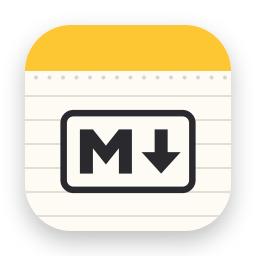

# Перо: пример документа

Обычный абзац с **жирным**, *курсивом*, ~~зачёркнутым~~ и `кодом в строке`. Вот [ссылка на сайт](https://example.com "Подсказка") и голый адрес https://example.org. Поставь курсор на любое слово с оформлением, и рядом появится разметка.

## Списки

- Первый пункт
- Второй пункт с **выделением**
  - Вложенный пункт
- Третий пункт

1. Раз
2. Два
3. Три

### Чек-лист

- [x] Собрать приложение
- [ ] Открыть свой файл
- [ ] Нажать на квадратик, чтобы отметить задачу

## Цитата

> Цитата может занимать несколько строк.
> Знак «>» виден только на строке с курсором.

## Таблица

| Возможность | Статус | Комментарий |
|:------------|:------:|------------:|
| Живой просмотр | готово | `CodeMirror` |
| Экспорт | готово | HTML и **PDF** |
| Таблицы |  | щёлкни по ячейке |

## Код

```swift
struct Greeting {
    let name: String
    func text() -> String { "Привет, \(name)!" } // комментарий
}
```

```js
const sum = (a, b) => a + b
console.log(sum(2, 3))
```

---

Картинка из соседнего файла:



Заголовок второго вида
----------------------

Последняя строка.
